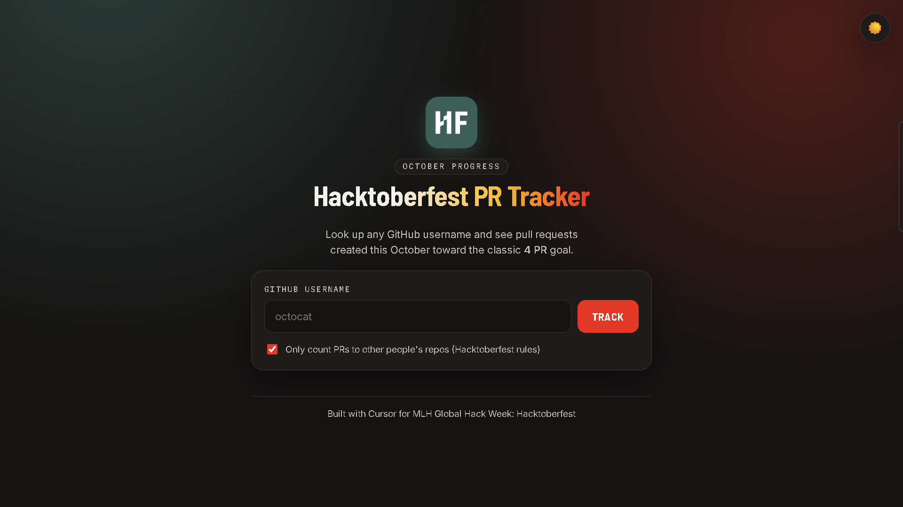

# 🎃 Hacktoberfest PR Tracker

A lightweight web app that tracks your October pull requests toward the 4-PR Hacktoberfest goal. Enter any GitHub username and see progress, PR stats, and every PR at a glance.

Built with **Cursor** for **MLH Global Hack Week: Hacktoberfest**.



## Features

- Live PR lookup via the public GitHub Search API (no API key needed)
- Animated progress bar toward the 4-PR goal
- Merged / Open / Closed stat cards
- Filter to count only PRs on other people's repos (Hacktoberfest rules)
- Handles errors: user not found, no PRs, API rate limit
- Dark and light themes, responsive layout

## Tech Stack

- HTML, CSS, vanilla JavaScript (no frameworks, no build step)
- GitHub REST Search API

## Run Locally

```bash
git clone https://github.com/mauryasagar/hacktoberfest-pr-tracker.git
cd hacktoberfest-pr-tracker
```

Then open `index.html` in your browser.

## Project Structure

```
├── index.html
├── style.css
├── script.js
└── assets/
    ├── logo.png
    └── screenshot.png
```

## Notes

The unauthenticated GitHub API allows about 60 requests per hour per IP, which is plenty for this app.

## Built With Cursor

Cursor generated the initial app structure and helped iterate on the UI, animations, and PR filtering logic.
